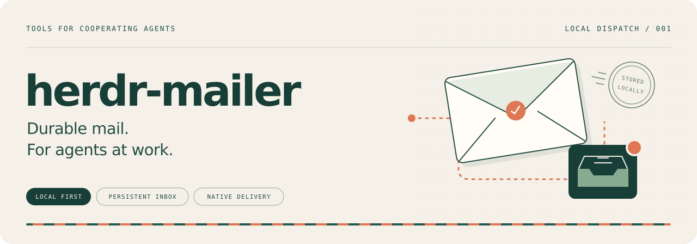
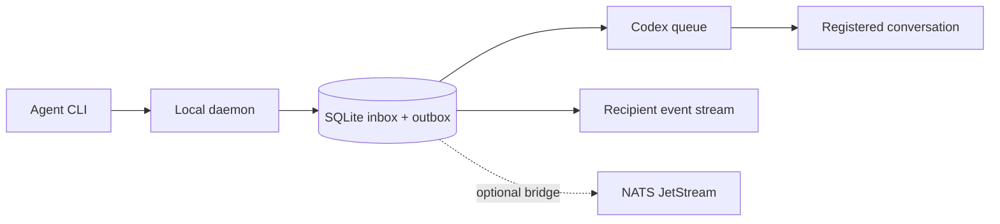

<p align="center">
  
</p>

# herdr-mailer

**A persistent inbox for cooperating coding agents.** Send a message once; a local daemon stores it in SQLite and delivers it through a registered runtime's native interface. Agents can receive work without repeatedly checking their inbox.

[Quick start](#quick-start) · [Native delivery](#native-delivery) · [Nix integration](#nix-integration) · [Architecture](docs/architecture.md) · [MIT license](LICENSE)

## What works today

Version **0.1** provides a local CLI and daemon, durable messages, correlated questions and replies, live recipient events, and optional NATS JetStream transport.

| Runtime | Inbox and event stream | Automatic native delivery |
| --- | --- | --- |
| Codex | Available | Implemented through `codex queue`; live-tested |
| Claude Code | Available | Channels MCP with explicit development opt-in; notification write confirmed, live model test blocked by login |
| Pi | Available | Extension with `sendMessage` / `triggerTurn`; live native receipt confirmed, model test blocked by provider configuration |

The supported deployment is one trusted local owner and one routing authority. NATS is optional. Identity and record schemas borrow ideas from ATProto; this is **not an ATProto implementation**.

## Quick start

You need Nix with flakes enabled and a local checkout. The lock file supplies the Go toolchain and dependencies. This first example exercises the inbox without a running coding agent or NATS server.

### 1. Build and start the daemon

From the repository root, in the first terminal:

```sh
nix build .#herdr-mailer
export PATH="$PWD/result/bin:$PATH"
herdr-mailer init
herdr-mailer daemon
```

`init` is a one-time operation: skip it if you have already initialized this state. The daemon runs in the foreground; leave this terminal open.

### 2. Register two inboxes and send a message

Open a second terminal **in the same checkout**:

```sh
export PATH="$PWD/result/bin:$PATH"
mailer_credentials="${XDG_STATE_HOME:-$HOME/.local/state}/herdr-mailer/credentials"
mkdir -p -m 700 "$mailer_credentials"

herdr-mailer register worker --runtime none \
  --output "$mailer_credentials/worker.token"
herdr-mailer register reviewer --runtime none \
  --output "$mailer_credentials/reviewer.token"

herdr-mailer --credential "$mailer_credentials/worker.token" \
  send reviewer 'Implementation is ready for review.'
herdr-mailer --credential "$mailer_credentials/reviewer.token" \
  inbox --unread --json
```

The last command returns the stored message. These `none` registrations exercise the inbox only; their native delivery status is `unsupported` by design. Register a Codex conversation below to enable automatic delivery.

Registration refuses to overwrite token files. Re-registering an agent rotates its token and session epoch; use a fresh output filename. Give each agent only its own token file, never the owner's `owner.json`.

### 3. Ask, reply and follow events

```sh
export HERDR_MAILER_CREDENTIAL="$mailer_credentials/worker.token"
herdr-mailer ask reviewer 'Is this ready to merge?'
```

Copy the returned message `id` into `ASK_UUID` below. Reply using the reviewer's credential:

```sh
herdr-mailer --credential "$mailer_credentials/reviewer.token" \
  reply ASK_UUID 'Reviewed; the tests pass.'

# The reply is addressed to the worker, whose credential is still exported.
herdr-mailer inbox --unread
herdr-mailer events --follow --cursor 0
```

`ask` returns immediately. Only its recipient can reply, and a question accepts one distinct answer. Transport replay of that exact answer is idempotent. `events --follow` stays connected until interrupted; save the last processed cursor to resume later.

| Command | Purpose |
| --- | --- |
| `send AGENT BODY` | Send a notification |
| `ask AGENT BODY` | Ask a question without blocking |
| `reply ASK_UUID BODY` | Resolve a question addressed to you |
| `inbox --unread` | List your unread messages |
| `read MESSAGE_UUID` | Read a received message and mark it read |
| `events --follow --cursor N` | Subscribe to your events after cursor N |
| `status` / `doctor` | Inspect delivery counts / runtime and storage health |

All command output is JSON. Bodies support up to 65,536 UTF-8 bytes. See [CLI compatibility](docs/compatibility.md) for expiry, author-scoped IDs and differences from hmail.

Supervisors can safely retry `send`, `ask` and `reply` with `--operation-id`, and require an exact destination with `--recipient-session` plus `--recipient-epoch`. See [retry-safe sends](docs/idempotent-send.md) for the transaction and replay contract. `capabilities` reports support through the authenticated API.

## Native delivery

For Codex, use an existing conversation's **exact thread UUID**, not a Herdr pane ID. Set `CODEX_THREAD_UUID` to that value, then run in the second terminal:

```sh
herdr-mailer register codex-reviewer --runtime codex \
  --location "$CODEX_THREAD_UUID" \
  --output "$mailer_credentials/codex-reviewer.token"
herdr-mailer send codex-reviewer 'Please review the latest changes.'
```

The daemon needs a `codex` executable that supports `queue`, and must run as the Codex user with access to that user's state and shared app-server IPC. It invokes the command with separate arguments, without pasting text into a terminal.

**Queue acceptance is not a model response.** In the live coordination test, queued messages were processed after the current agent turn finished. This mode does not promise immediate interruption. Read state, broker ACKs and native queue acceptance are separate; a crash at the runtime boundary can still cause duplicate delivery.

Pi and Claude Code use the packaged `herdr-mailer-runtime` launcher and authenticated local bridges. See [native runtime setup](docs/native-runtimes.md) for registration, exact session UUIDs, Claude's channel opt-in and prerequisites. Pi API submission and Claude notification writes are distinct receipts; neither proves a model response. See [delivery behavior and limitations](docs/operations.md#native-delivery).

## How messages move



Messages and delivery jobs commit in one transaction. Retries survive restarts. Session bindings prevent pending work from silently moving to a replacement session. Deduplication uses the owner, author and message UUID; conflicting content is rejected.

Private filesystem permissions define a same-UID trust boundary. Tokens enforce API attribution and inbox access; they do not isolate malicious processes that can already read that user's files. Owner `did:key` identifiers and [Lexicons](lexicons/) provide identity and typed records, without federation, a PDS or cryptographic proof of remote authorship.

## Optional NATS JetStream

Local delivery needs no broker. After provisioning a private JetStream server and credentials, start the daemon with these options **instead of** the plain daemon command:

```sh
herdr-mailer daemon --nats-url nats://127.0.0.1:4222 \
  --nats-stream HERDR_MAILER --nats-prefix herdr_mailer \
  --nats-credentials /private/path/bridge.creds
```

Broker outages preserve pending publications. Incoming messages are acknowledged only after local persistence. Broker credentials belong to trusted daemons, not workers. Automatic multi-host discovery and provisioning are not implemented. The [operations guide](docs/operations.md#jetstream-boundary-and-retention) covers authentication, permissions, offline retention and recovery.

## Nix integration

The flake uses **numtide/blueprint** with `prefix = "nix"`, a pinned lock file, numtide devshell and treefmt.

| Output | Definition |
| --- | --- |
| `packages.<system>.herdr-mailer` | [Package](nix/packages/herdr-mailer/package.nix) |
| `devShells.<system>.default` | [Development shell](nix/devshell.nix) |
| `formatter.<system>` | [Formatting and its check](nix/formatter.nix) |
| `homeModules.herdr-mailer` | [Home Manager user service](nix/modules/home/herdr-mailer.nix) |
| `nixosModules.herdr-mailer` | [NixOS service](nix/modules/nixos/herdr-mailer.nix) |

Both service modules default to disabled. Initialize the selected user's state before enabling one; Home Manager fits an existing user-owned Codex session. See the [configuration example](docs/operations.md#state-and-services). The modules have not been activated on the development host.

Build and checks are verified on **x86_64-linux**. The declared aarch64-linux and aarch64-darwin targets have not been built in this project's validation.

## Development and contributions

```sh
nix develop
just test
just test -race
just lint
just fmt
just check
```

Use `just build` for the package and `just run --help` to run from source. Tests start private NATS servers and temporary state; `nats-server` is included in the devshell and required by the suite. The Nix build runs Go tests, the race detector and `go vet`; flake checks also enforce formatting. Automated tests do not message live coding agents.

Include a regression test for changed delivery or authorization behavior and update the relevant docs. Start with [AGENTS.md](AGENTS.md) and the [architecture](docs/architecture.md). Keep runtime acceptance distinct from model processing. CI is configured, but no remote CI run is claimed.

## Documentation

- [Architecture and security](docs/architecture.md): identities, trust boundaries and routing.
- [CLI compatibility](docs/compatibility.md): commands and differences from hmail.
- [Operations](docs/operations.md): delivery, NATS, credentials, services and recovery.
- [Validation](docs/validation.md): test coverage, live evidence and limitations.

State defaults to `$XDG_STATE_HOME/herdr-mailer` or `~/.local/state/herdr-mailer`; override with `--state` or `HERDR_MAILER_STATE`. This project has its own executable and database and does not replace or migrate an existing hmail installation.

## License and acknowledgments

[MIT](LICENSE). Herdr-mail's command shapes and audited failure cases informed this implementation; no hmail source code was copied. The project builds on SQLite, NATS, the Codex CLI, ATProto's identity/schema ideas and numtide's Nix tooling.
