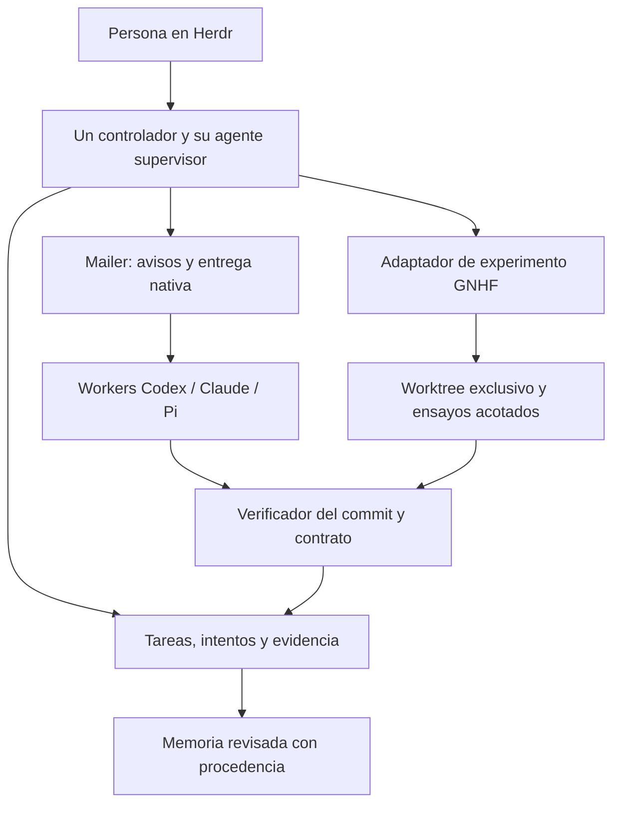

# Ampliación: coordinación y experimentación con agentes

Investigación del 4 de octubre de 2026. Complementa [viabilidad del supervisor](supervisor-feasibility.md); no instala ni implementa otro controlador.

**Revisión posterior:** el [estudio profundo de herdr-projects](herdr-projects-assessment.md) ejecuta la suite y pruebas independientes. Recomienda Projects como base adaptada, no como sustituto sin cambios: confirma límites de ejecución y un fallo de reparto entre proyectos que comparten host remoto.

**La recomendación anterior de construir directamente un plugin propio debe quedar condicionada a evaluar herdr-projects.** Es un candidato mucho más cercano a nuestro producto de lo que recogía la primera comparación. Pi Herdsman merece una comparación paralela si aceptamos que la coordinación dependa de Pi. GNHF es útil para ejecutar iteraciones dentro de una tarea.

Se inspeccionaron doce repositorios públicos en revisiones fijadas, incluidos documentación, manifiestos y rutas de código relevantes. No se ejecutaron sus agentes, instaladores, suites ni pruebas de recuperación: la presencia de tests no demuestra que pasen aquí. Las conclusiones de adopción son juicios de encaje, no certificaciones de fiabilidad. Las [fuentes y revisiones](research/ecosystem/revisions.json) permiten repetir la revisión. Los resultados del estudio anterior siguen siendo la evidencia sobre nuestra instalación: Herdr 0.9.1/protocolo 22 y Pi 0.87.1, no las versiones anunciadas por los proyectos nuevos.

## Selección prioritaria

| Proyecto | Aportación nueva | Encaje con Herdr + mailer | Decisión propuesta |
| --- | --- | --- | --- |
| [herdr-projects](https://github.com/eliasstravik/herdr-projects) | Coordinador, trabajadores, memoria, inbox, rutinas y seguimiento de PR | Ya usa worktrees e interfaz de Herdr; Rust; declara Herdr 0.9.1+ | Primer candidato para adaptar antes de construir otro controlador |
| [Pi Herdsman](https://github.com/boadij/pi-herdsman) | Jerarquía de supervisión, propiedad explícita y continuidad por rama | Integración profunda con Pi/Herdr; mensajería propia | Candidato si Pi puede ser la plataforma central; requiere revisar versiones |
| [pi-workflows](https://github.com/osolmaz/pi-workflows) | Workflows y reconciliadores con estado durable y evidencias de turnos | Pi, servidor SQLite y visor integrado en Herdr | Referencia técnica fuerte; candidato si priorizamos automatizaciones Pi |
| [GNHF](https://github.com/kunchenguid/gnhf) | Iterar, registrar aprendizajes, conservar o descartar cambios | CLI con adaptadores Claude, Codex, Pi y otros | Ejecutor acotado dentro de un intento, con verificación exterior |
| [Agent Orchestrator](https://github.com/useagent/ao) | Sesiones por issue y reacciones a CI/reviews mediante plugins | Separa runtime, agente, workspace, tracker y notificaciones | Alternativa si el producto principal es issue → PR |

### herdr-projects: el candidato que cambia la decisión

Tiene un coordinador conversacional, tareas y trabajadores en worktrees separados, memoria compartida, informes y una vista de qué necesita atención. También contempla máquinas SSH y rutinas. Declara compatibilidad desde Herdr 0.9.1. Eso coincide con buena parte del producto que queremos. [README](https://github.com/eliasstravik/herdr-projects/blob/4e4548c3c43888e6be1c96906215998f07dc63f0/README.md).

Su estado vive en archivos Markdown/TOML/JSON. El código usa locks de proyecto y escrituras temporales con `sync_all` y rename: no sería correcto descartarlo como «solo prompts sin persistencia». Un ticker hace observaciones cada 15 segundos; PRs y máquinas remotas tienen frecuencias distintas. El coordinador razona; los subcomandos realizan operaciones mecánicas. Aunque la documentación diga «no daemon», sí existe un proceso ticker en segundo plano. [Operaciones](https://github.com/eliasstravik/herdr-projects/blob/4e4548c3c43888e6be1c96906215998f07dc63f0/docs/operations.md), [persistencia](https://github.com/eliasstravik/herdr-projects/blob/4e4548c3c43888e6be1c96906215998f07dc63f0/src/project.rs).

La entrega actual da una oportunidad concreta a mailer: el ticker observa que el coordinador está disponible, espera una caja de entrada vacía y llama a `herdr agent prompt`. Los briefs tienen claims temporales, intentos y diagnóstico de envío atascado. Esto es más elaborado que pegar texto ciegamente, pero no equivale a nuestro registro de destinatario UUID/epoch ni a un recibo funcional del modelo. [Nudges](https://github.com/eliasstravik/herdr-projects/blob/4e4548c3c43888e6be1c96906215998f07dc63f0/src/steps.rs), [registros de threads](https://github.com/eliasstravik/herdr-projects/blob/4e4548c3c43888e6be1c96906215998f07dc63f0/src/thread.rs).

**Adaptación propuesta:** conservar Projects como propietario del proyecto, sus threads y recursos Herdr; añadir un adaptador que use mailer para avisar de cambios y despertar sesiones registradas. El receptor consulta el estado vigente antes de actuar. Añadir entrega nativa exige también integrar el launcher/registro, los reintentos y la recuperación; no basta sustituir una llamada por `mailer send`. Primero medir ese coste. No crear simultáneamente otra tabla autoritativa con las mismas tareas.

Queda por ensayar la recuperación real entre creación de recursos y escritura de registros, la sustitución de sesiones, la revisión ligada a un SHA concreto y el bootstrap de los tres runtimes. No he demostrado que esos contratos estén resueltos por Projects ni que requieran reescribirlo.

### Pi Herdsman: una jerarquía de agentes ya implementada

Separa **Chief → Manager → Lead** para supervisión y **Lead → Agent → Agent** para propiedad de ejecución. El trabajo de proyecto continúa identificado por repositorio/rama aunque cambie el Manager. La entrega de un informe no termina automáticamente la asignación; puede seguir en revisión. Son conceptos que habíamos propuesto y que aquí ya tienen interfaces concretas. [Coordinación por proyecto](https://github.com/boadij/pi-herdsman/blob/9e5bbd7bc81afedbd95623a4ca4b2af89487a25e/docs/guides/project-orchestration.md).

El código conserva IDs de solicitud, propietario, sesión Pi, pane y ejecución; usa buzones en archivos, locks y generaciones. La supervisión llama a `sendMessage` con `followUp` y `triggerTurn`. No debe evaluarse como simple fan-out de terminales. [Mailbox](https://github.com/boadij/pi-herdsman/blob/9e5bbd7bc81afedbd95623a4ca4b2af89487a25e/extension/mailbox.ts), [supervisión](https://github.com/boadij/pi-herdsman/blob/9e5bbd7bc81afedbd95623a4ca4b2af89487a25e/extension/supervision.ts).

La revisión consultada declara Node >=22.19, Pi **1.0.1** y Herdr **0.9.3** como baseline. Nuestra combinación verificada es anterior. Tampoco convierte Codex y Claude en participantes nativos equivalentes por usar modelos de sus proveedores desde Pi. [Manifiesto](https://github.com/boadij/pi-herdsman/blob/9e5bbd7bc81afedbd95623a4ca4b2af89487a25e/package.json).

Usaría su diseño de roles como referencia. Adoptarlo supondría elegirlo como autoridad y diseñar un puente para los runtimes externos; reemplazar sus buzones por mailer sería una adaptación sustancial, no una configuración existente.

### pi-workflows: duración y recuperación con contratos explícitos

Combina grafos TypeScript finitos con reconciliadores de recursos duraderos: estado deseado/observado, cola, claims, revisiones y efectos externos. El servidor es el propietario de SQLite; extensión, CLI y visor hablan su protocolo. [Gestores de recursos](https://github.com/osolmaz/pi-workflows/blob/7937df1a6b4f12bfce2e7ada2842d5556dd95f72/docs/RESOURCE_MANAGERS.md).

La documentación y el código distinguen efectos pendientes, aplicados e inciertos; vinculan escrituras a claims/generaciones y usan evidencia de la sesión Pi para los mensajes de workflow. Es una referencia cercana a nuestros invariantes. Un límite de adopción concreto: documenta un cambio de esquema alpha incompatible con el formato anterior, sin migración. [Estado SQLite](https://github.com/osolmaz/pi-workflows/blob/7937df1a6b4f12bfce2e7ada2842d5556dd95f72/docs/SQLITE_STATE.md), [efectos](https://github.com/osolmaz/pi-workflows/blob/7937df1a6b4f12bfce2e7ada2842d5556dd95f72/src/resource-managers/effects.ts), [transacciones](https://github.com/osolmaz/pi-workflows/blob/7937df1a6b4f12bfce2e7ada2842d5556dd95f72/src/resource-managers/sqlite.ts).

Lo evaluaría para automatizaciones cuyo ejecutor sea Pi. Para un supervisor heterogéneo hay que estudiar la separación del motor respecto al protocolo y las evidencias de Pi. No asumiría que añadir mailer proporciona automáticamente esa portabilidad.

## GNHF: el proyecto que recordabas

[kunchenguid/gnhf](https://github.com/kunchenguid/gnhf) significa *good night, have fun*. Ejecuta iteraciones con agentes no interactivos, guarda notas e historial, hace commits de avances y descarta intentos fallidos. Ofrece límites de iteraciones/tokens, reanudación, worktree opcional y condiciones de parada. Los límites de iteraciones y tokens son ilimitados por defecto. Su skill describe un modo Companion con un agente exterior supervisando el bucle. [README](https://github.com/kunchenguid/gnhf/blob/f2ad5baff8de453bd4222e3d6ce53b43522b1fa2/README.md).

Hay tres detalles decisivos en el código:

1. **Éxito y parada dependen de la declaración del agente.** El prompt pide ejecutar pruebas, pero el orquestador decide conservar cambios con `result.output.success`; `should_fully_stop` procede también del agente. No sustituye un verificador independiente. [Prompt](https://github.com/kunchenguid/gnhf/blob/f2ad5baff8de453bd4222e3d6ce53b43522b1fa2/src/templates/iteration-prompt.ts), [orquestador](https://github.com/kunchenguid/gnhf/blob/f2ad5baff8de453bd4222e3d6ce53b43522b1fa2/src/core/orchestrator.ts).
1. **Sus permisos por defecto difieren de nuestra política.** El adaptador Codex añade `--dangerously-bypass-approvals-and-sandbox` salvo override de ejecución; Claude añade `--dangerously-skip-permissions` salvo modo explícito. ACP configura `approve-all`. Habría que fijar el perfil y probar los argumentos efectivos. [Codex](https://github.com/kunchenguid/gnhf/blob/f2ad5baff8de453bd4222e3d6ce53b43522b1fa2/src/core/agents/codex.ts), [Claude](https://github.com/kunchenguid/gnhf/blob/f2ad5baff8de453bd4222e3d6ce53b43522b1fa2/src/core/agents/claude.ts), [ACP](https://github.com/kunchenguid/gnhf/blob/f2ad5baff8de453bd4222e3d6ce53b43522b1fa2/src/core/agents/acp.ts).
1. **Gestiona el Git del bucle.** Los fallos pueden llevar a `reset --hard`. Debe tener un checkout exclusivo. Hay adaptadores nativos para Claude, Codex y Pi, pero son ejecuciones controladas por GNHF, no adopción automática de nuestras conversaciones existentes. [Factoría](https://github.com/kunchenguid/gnhf/blob/f2ad5baff8de453bd4222e3d6ce53b43522b1fa2/src/core/agents/factory.ts), [Git](https://github.com/kunchenguid/gnhf/blob/f2ad5baff8de453bd4222e3d6ce53b43522b1fa2/src/core/git.ts).

**Uso propuesto:** el supervisor asigna un intento y worktree exclusivo; un adaptador inicia GNHF en esa rama, sin crear otro worktree ni hacer push, con presupuesto y perfil explícitos. Al terminar, el adaptador publica el commit y los artefactos. Un verificador exterior decide si se acepta. Mailer transporta avisos entre el supervisor y el adaptador; no convierte mágicamente el proceso GNHF en una sesión nativa registrada.

Buenos primeros objetivos: reducir tiempo de una prueba reproducible, mejorar un parser contra un corpus fijo o reducir tamaño de un artefacto conservando su comportamiento. «Mejora todo el proyecto indefinidamente» no proporciona un criterio de aceptación útil.

## Otras piezas que amplían el diseño

| Proyecto | Qué tomaríamos | Límite o coste relevante |
| --- | --- | --- |
| [Agent Orchestrator](https://github.com/useagent/ao/blob/e55012793c90e1a6f01fe47530139045d95f0d9a/README.md) | Reacciones a fallos CI/reviews; adaptadores separados de runtime, agente y workspace | No se encontró un plugin Herdr ni Pi entre los plugins inspeccionados. Requiere adaptación; mantiene su propio ciclo de sesiones |
| [Gas Town](https://github.com/gastownhall/gastown/blob/649b832b7672bc7a2dbef26f5983aba6198b819b/README.md) | Trabajo persistente, handoffs, fórmulas repetibles, capacidad y cola de integración | Sistema amplio con correo, roles, workspaces y tmux; adoptarlo entero solapa Herdr y mailer |
| [Beads](https://github.com/gastownhall/beads/blob/c4305ff01ec70823d4346630ca8a959adeaa1027/README.md) | Grafo de dependencias y memoria de trabajo que sobrevive al chat | El backend actual es Dolt. Usarlo como backlog requiere decidir quién posee estado, asignación y cierre |
| [MCP Agent Mail](https://github.com/Dicklesworthstone/mcp_agent_mail/blob/3fad5ec672869f81d2ca0a4c525dde004ac96f45/README.md) | Reservas voluntarias de archivos, historial buscable y conversaciones por tema | HTTP/MCP y otra autoridad de mensajes; no reemplaza por sí solo nuestra entrega nativa. Su LICENSE contiene un rider adicional; no asumir MIT sin modificaciones |
| [autoresearch](https://github.com/karpathy/autoresearch/blob/228791fb499afffb54b46200aca536f79142f117/program.md) | Baseline, métrica fija, presupuesto por ensayo y registro de conservar/descartar | El original es entrenamiento de modelos, no un supervisor general; trasladar el método exige un evaluador adecuado al proyecto |
| [Symphony](https://github.com/openai/symphony/blob/be10a1b79df723d6d7612b5651c8522704dafb2e/SPEC.md) | Contrato `WORKFLOW.md`, reconciliación, límites de concurrencia y separación tracker/worker | Preview; recuperación basada en tracker/filesystem, sin restaurar exactamente el scheduler en memoria; no es un plugin Herdr |
| [AgentBox](https://github.com/madarco/agentbox/blob/605ee75d63319003c188bc532d4e5b2ba36a51d6/README.md) | Entornos de ejecución separados y ejecución Docker remota por SSH | Añade aprovisionamiento. El backend Docker local es un contenedor; no asumir que toda «box» es una VM |
| [Pi Overseer](https://github.com/SecretAardvark/pi-overseer/blob/9517b2302e0a4f8cafdfb48ff24dc98a7386e9a1/docs/overseer-dogfood.md) | Selección de worker por rol/complejidad y handoffs con requisitos de revisión | Basado en Pi, td y JJ; el manifiesto es privado 0.1.0. Sus gates reciben hechos declarados; no son por sí solos un sandbox ni prueba independiente |

En Agent Orchestrator, `Runtime.sendMessage` es parte de la interfaz, además de `create`/`destroy`. Por tanto, una propuesta real sería **runtime Herdr + workspace Herdr + entrega mailer**, junto con un plugin Pi y revisión del ciclo de vida. Un notifier mailer solo enviaría avisos; no resolvería la comunicación completa de workers. [Interfaces](https://github.com/useagent/ao/blob/e55012793c90e1a6f01fe47530139045d95f0d9a/packages/core/src/types.ts).

AgentBox ya incluye un [manifiesto Herdr](https://github.com/madarco/agentbox/blob/605ee75d63319003c188bc532d4e5b2ba36a51d6/herdr-plugin.toml). Su backend SSH podría usar conectividad proporcionada por NetBird: es una posibilidad de composición, no integración NetBird nativa comprobada ni soporte multihost ya existente en nuestro mailer.

La diferencia útil de autoresearch frente a confiar en `success=true` es un criterio medible con un evaluador que el trabajador no debe cambiar. Esa restricción en `program.md` sigue siendo una instrucción al agente; para nuestro motor habría que hacerla cumplir desde fuera. Las reservas de MCP Agent Mail inspiran claims de módulos, API o migraciones: worktrees distintos evitan compartir el checkout, pero no evitan cambios incompatibles en el mismo contrato.

## Protocolos: cada uno resuelve una frontera distinta

- [ACP](https://github.com/agentclientprotocol/agent-client-protocol/blob/main/docs/protocol/v1/draft/overview.mdx) estandariza interacción cliente/agente: inicializar, crear/cargar sesión, enviar prompts, recibir eventos y solicitar permisos. Puede reducir adaptadores para runtimes que lo implementen; no garantiza que podamos adjuntarnos a cualquier sesión TUI existente.
- [A2A](https://a2a-protocol.org/latest/specification/) modela tareas, estados, mensajes y artefactos entre servicios de agentes. Sería una frontera de interoperabilidad futura; no aporta por sí solo nuestro scheduler, worktrees o transacciones locales.
- Los DID/records inspirados en ATProto pueden seguir identificando autores y mensajes en mailer. No hace falta incorporar federación para adoptar un esquema versionado de tarea/artefacto. NATS sigue siendo transporte opcional, no la autoridad sobre el estado de las tareas.

No añadiría ACP y A2A solo por estandarizar nombres: primero un caso real que necesite cada interfaz. En esta investigación se revisaron las especificaciones, no implementaciones interoperables ni compatibilidad con nuestras sesiones instaladas.

## Cambios concretos a nuestra propuesta

1. **Evaluar adaptación antes de construir.** Probar herdr-projects contra los contratos que necesitamos y estimar los cambios de entrega/recuperación. Si los huecos afectan a todo su modelo de autoridad, conservar el controlador propio como alternativa.
1. **Separar tarea de entrega y experimento.** Una tarea entrega un cambio que cumple un contrato; un experimento produce observaciones comparables y quizá un candidato. Un resultado prometedor no autoriza integración.
1. **Conservar conocimiento con procedencia.** Registrar hallazgo, repo/base/commit, prueba y decisión; promoverlo a memoria de proyecto tras revisión. No convertir automáticamente cualquier mensaje en una instrucción permanente.
1. **Distinguir salud del proceso de progreso de la tarea.** Observar sesiones y reiniciar un proceso no demuestra avance ni autoriza duplicar un trabajador incierto.
1. **Controlar recursos y conflictos semánticos.** Además de concurrencia, reservar recursos compartidos cuando proceda: puertos, GPU, servicios de prueba, migraciones o contratos en disputa.
1. **Elegir un único controlador por ejecución.** Projects, Herdsman, AO o nuestro motor pueden poseer tareas. Mailer conserva mensajes y recibos. Herdr conserva la interfaz y sus recursos. No sincronizar varios schedulers como autoridades iguales.

La topología que propongo evaluar es:

El controlador podría ser Projects adaptado o el componente propio; este diagrama no afirma que esas integraciones ya existan. Los huecos conocidos de mailer siguen pendientes, especialmente la clave de operación en el envío local y las precondiciones de destinatario necesarias para reintentos seguros. Véase [diseño del supervisor](supervisor-design.md).

## Evaluación siguiente y criterio de elección

Primero haría una prueba acotada de **Projects + mailer**, con un objetivo pequeño, dos trabajadores como máximo y estado aislado. Compararía con nuestro diseño estas situaciones: reinicio del coordinador, destinatario sustituido, respuesta tardía, timeout después de crear un worktree y resultado referido a un commit que ya cambió. El criterio es continuar sin duplicar recursos ni aceptar evidencia obsoleta. Estos ensayos están propuestos, no ejecutados.

Después probaría **GNHF como ejecutor** en un intento independiente, con un límite corto, permisos fijados y verificador externo. Mediría tareas aceptadas, coste observado, tiempo de revisión e intervenciones humanas. Las cifras de marketing o el número de agentes lanzados no sustituyen esas medidas.

Herdsman entra en la prueba si se autoriza evaluar su combinación Pi/Herdr en un entorno separado. AO gana prioridad si decidimos trabajar principalmente desde issues y PRs. Gas Town sería una decisión de plataforma, no otro plugin que añadir al conjunto.

En Nix, fijaría las revisiones y dependencias antes de empaquetar; Projects requiere Cargo, GNHF Node, y pi-workflows también SQLite nativo y su visor Rust. No se ha construido ninguno con Nix en esta ampliación y no se propone ejecutar instaladores que modifiquen configuración global.

El repositorio sugerido `yigitkonur/herdr-pm` no pudo descargarse públicamente en esta revisión. Se excluye de la recomendación: no se deduce de ese fallo si fue retirado, renombrado o hecho privado. Los índices del marketplace sirvieron para descubrir candidatos; el análisis se basó en las fuentes fijadas, no en estrellas ni snippets antiguos.
