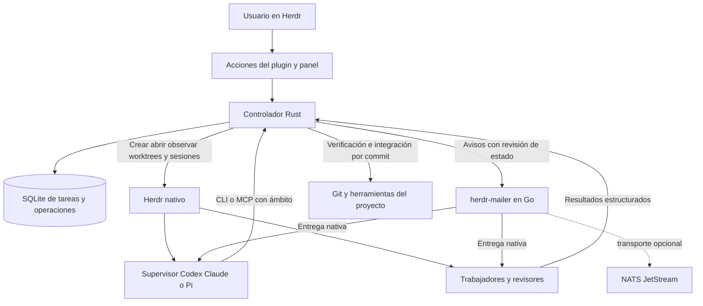

# Viabilidad de un supervisor de agentes para Herdr

Fecha: 4 de octubre de 2026. Estudio y propuesta, no implementación del supervisor.

**Actualización del mismo día:** la [ampliación del ecosistema](ecosystem-expansion.md) incorpora herdr-projects, Pi Herdsman, pi-workflows, GNHF y otras alternativas que no cubría esta primera comparación. La recomendación actual es evaluar **herdr-projects + mailer antes de construir un controlador nuevo**. Las pruebas e invariantes de este documento siguen siendo aplicables; la elección de implementar desde cero queda condicionada a esa evaluación.

**Propuesta original, ahora alternativa condicionada: plugin propio en Rust, pequeño y separado de mailer, que use la gestión nativa de worktrees y sesiones de Herdr.** Un controlador persistente conserva tareas y aplica reglas; una sesión real de Codex, Claude o Pi toma las decisiones que requieren razonamiento. Mailer comunica y despierta a los agentes. SQLite conserva el estado de la coordinación. NATS sigue siendo opcional y pertenece a mailer.

Rust y Go son técnicamente viables. La recomendación de Rust es una decisión de diseño para un componente nuevo con estados explícitos y una posible TUI; **no se basa en acceso privilegiado a Herdr, en una mejora de rendimiento medida ni en que Go carezca de SDK**. Las consultas reales con ambos lenguajes funcionaron.

El esquema implementable, las transiciones y los contratos están en [diseño del supervisor](supervisor-design.md). Las revisiones consultadas y los experimentos están en [evidencias](research/supervisor/evidence.md).

## Alcance y criterios

El objetivo es dar una meta a un supervisor visible en Herdr, que divida el trabajo, abra trabajadores Codex/Claude/Pi en worktrees independientes, reciba preguntas y resultados sin comprobaciones periódicas del modelo, revise commits concretos y recupere el trabajo tras desconexiones.

La exploración cubre las familias que podrían resolver ese objetivo: primitivas de Herdr, plugins existentes, equipos nativos de un proveedor, frameworks de agentes, motores durables genéricos, proyectos locales ya existentes y un controlador propio. No es posible demostrar que se ha inspeccionado cada repositorio publicado; sí comparar las alternativas materialmente diferentes y los candidatos cercanos, con criterios explícitos.

| Criterio | Condición que buscamos |
| --- | --- |
| Encaje con el usuario | Herdr visible, worktrees propios, runtimes nativos heterogéneos, Nix, funcionamiento local |
| Recuperación | Sobrevivir al cierre del chat; no duplicar trabajadores ante un timeout |
| Verificación | Evidencia ligada a tarea, intento, revisión del contrato y commit exacto |
| Comunicación | Mailer nativo; distinguir entrega, aceptación del runtime y trabajo completado |
| Control | Límites de concurrencia y reintentos; integrar solamente lo autorizado |
| Mantenimiento | Pocas autoridades de estado; versiones comprobadas; evitar motores y registros duplicados |

La ausencia de federación y de multihost automático es deliberada. NetBird y Collie pueden seguir siendo acceso remoto o interfaz; no son requisitos del motor local.

## Estado realmente inspeccionado

- Herdr cliente y servidor **0.9.1, protocolo 22**, compatibles y sin reinicio pendiente. Se exportó su esquema, no se supuso que la documentación de una versión posterior describiera el binario instalado.
- Mailer **96efe7bb1dd1f18a25e2420e723d5ed7a75a137b**, checkout inicialmente limpio. Se probaron sockets y persistencia con su paquete Nix ya construido.
- `herdr-lanes` **d0783e566a4550c9084e33eb7b56333537146967**, limpio: adopción e identidad persistente de worktrees/sesiones; no crea trabajadores ni ejecuta una misión autónoma. Su contrato actual se dirige al protocolo 20.
- Compilación y consultas de lectura con Rust 1.98.1, `herdr-sdk` 0.0.1, `herdr-plugin` 0.1.8 desde revisión fijada, y Go 1.26.7 con `cyperx84/herdr-api` desde revisión fijada.

No se instalaron plugins, no se lanzaron agentes ni se consumieron modelos en este estudio. Las pruebas de mailer usaron identidades `runtime=none` en estado temporal. Las pruebas de Git usaron un repositorio desechable.

## Qué reutilizar de Herdr

**Sí: Herdr ya gestiona worktrees.** En la versión instalada, `worktree.create` crea el checkout y abre un workspace, devolviendo `workspace`, `tab`, `root_pane` y `worktree`. No necesitamos reproducir esa operación con `git worktree add` y después reconstruir la interfaz por nuestra cuenta.

| Capacidad nativa comprobada | Uso propuesto | Qué seguirá siendo responsabilidad del supervisor |
| --- | --- | --- |
| `worktree.create` con base, rama, ruta y foco | Un worktree por intento; base resuelta previamente a un commit | Relación tarea/intento, exclusividad y reconciliación de efectos inciertos |
| `worktree.list` | Recuperar checkout, rama y workspace abierto | Verificar continuidad del repositorio y propiedad del recurso |
| `worktree.open` y `already_open` | Reabrir recursos existentes tras pérdida de interfaz | No lanzar otro agente porque se haya abierto un panel |
| `worktree.remove` | Retirada explícita de recursos terminados | Política de retención, cambios ignorados, actividad y permisos de borrado |
| `agent.start`, `agent.get`, `agent.list` | Arranque cuando el perfil sea compatible e inspección de identidad nativa | Bootstrap de mailer, credenciales y recibo funcional del trabajador |
| CLI `pane run`, panes y pestañas | Arranque del launcher que configura Claude/Pi; verificadores visibles | Citar argumentos correctamente y atribuir el proceso al intento |
| `events.subscribe`, `session.snapshot`, `ping` | Reaccionar a actividad y reconciliar tras desconexión | Estado durable de tareas; una señal `idle` no aprueba trabajo |
| `pane.process_info`, `agent.read` | Diagnóstico de bloqueo o arranque incierto | No convertir texto de terminal en evidencia de tests o autorización |
| `pane.report_metadata`, `workspace.report_metadata` | Mostrar tarea, intento y fase en la interfaz existente | La metadata es visual, no un registro autoritativo |
| `notification.show` | Señalar intervención necesaria | Agrupar avisos para no saturar al usuario |
| Acciones y paneles de plugins | Iniciar, ver, pausar, reanudar y revisar una ejecución | API común para CLI, MCP y panel; no lógica separada en cada superficie |
| Persistencia de sesiones de Herdr | Conservar/reabrir la interfaz y observar procesos existentes | Reconstruir el objetivo, sus criterios y las decisiones pendientes |

`worktree list` reconoció el checkout principal y el worktree `feat/native-runtimes` de mailer, con sus workspaces abiertos. La validación de este estudio es de esquema, ayuda instalada y consulta real; no se volvió a crear/eliminar un worktree a través del servidor compartido para ensayar esa mutación.

En 0.9.1 no aparece un comando nativo `worktree merge`/`land` en la superficie instalada. Revisar e integrar commits seguirá usando Git bajo reglas del controlador. No hay que atribuir al Herdr instalado comandos encontrados en forks o versiones posteriores. Los worktrees comparten objetos y referencias Git: aíslan checkouts, no son un sandbox de seguridad. [Git worktree](https://git-scm.com/docs/git-worktree).

## Alternativas comparadas

Las conclusiones de encaje son juicios de este estudio. Los hechos se contrastaron con los README y rutas de código de las revisiones enumeradas en las evidencias; no se ejecutaron todas las suites ni se certifica la calidad general de esos proyectos.

| Opción | Qué aporta hoy | Adaptación necesaria para nuestro objetivo | Decisión |
| --- | --- | --- | --- |
| Herdr + instrucciones al supervisor | Primitivas nativas, mínima infraestructura | Falta un registro de tareas y reconciliación independiente del chat | Útil para trabajo asistido; insuficiente como motor recuperable |
| [herdr-swarm](https://github.com/StructuPath/herdr-swarm) | Fan-out, worktree por agente, visibilidad Git e integración precedida por revisión | Añadir planificación dinámica, contratos, mailer y recuperación del supervisor; la compatibilidad declarada no sustituye una prueba en 0.9.1 | Mejor opción existente para fan-out atendido; tomar su disciplina de integración |
| [herdr-loop](https://github.com/cyperx84/herdr-loop) | Ciclos TOML de implementar, revisar, validar y repetir, guiados por eventos | Grafo actual secuencial; nuevo control durable de misión y comunicación por mailer | Buen motor de ciclos declarados; no adoptar como autoridad de nuestra misión |
| [herdr-dispatch](https://github.com/husniadil/herdr-dispatch) | Daemon, tablero `herdr-tasks`, capacidad, despacho CLI/MCP y parada en revisión | Otro tablero autoritativo y adaptación importante del launcher: el perfil Codex documentado usa Claude mediante Proxenos | Cercano funcionalmente, pero no una integración directa con nuestros tres runtimes nativos |
| [herdr-conductor](https://github.com/StructuPath/herdr-conductor) | Contratos, revisión por SHA, journal e integración controlada | Flujo atendido y contrato publicado fijado a 0.7.5; candidato de desarrollo específico 0.9.3, no 0.9.1 | Referencia para invariantes, no base instalable de esta solución |
| [herdr-workflows](https://github.com/aorumbayev/herdr-workflows) | Secuencias YAML, comandos, agentes, subworkflows e historial | Añadir planificación, propiedad de intentos y recepción nativa | Adecuado para recetas y comprobaciones repetibles, no para toda la coordinación |
| [herdr-orchestrator](https://github.com/sean1588/herdr-orchestrator) | Grafo de estados, SQLite, pipeline GitHub issue → PR y control MCP | Desacoplar intake/merge de GitHub y supervisión periódica; integrar mailer y objetivo abierto | Preferible si el producto buscado fuera una fábrica de PRs basada en issues |
| [Herdforge](https://github.com/Kampe/Herdforge) | Primitivas de selección, verificación, revisión e integración con Herdr | El propio proyecto señala lifecycle durable aún incompleto, Pi no soportado y políticas de modelos específicas | Demasiado alcance y supuestos para adoptarlo aquí |
| [Meshloop](https://github.com/smota/meshloop) | Motor Rust con DAG, ejecución directa, worktrees y comprobaciones | Su ADR 0022 y código actual han retirado Herdr; las crates publicadas antiguas conservan documentación de ese adaptador | No usar como base Herdr; no confundir documentación indexada con código actual |
| `herdr-lanes` local | Identidad persistente, adopción, observación y sustitución explícita de participantes | Actualizar protocolo y construir tareas, despacho y recuperación; actualmente Python, sin daemon | Reutilizar conceptos y pruebas; convivir mediante importación explícita, no sincronización bidireccional |
| [workmux](https://github.com/raine/workmux) | Worktrees, terminales y delegación | El checkout local inspeccionado se centra en tmux/Kitty/WezTerm; añadir otra capa de terminales duplicaría Herdr | No incorporarlo a esta arquitectura |
| [Claude Agent Teams](https://code.claude.com/docs/en/agent-teams) | Supervisor, tareas y mensajes entre Claude Code | No satisface el requisito de tres runtimes nativos; experimental, con límites de recuperación documentados | Válido si el usuario decide trabajar solamente con Claude |
| [LangGraph](https://docs.langchain.com/oss/python/langgraph/persistence) | Grafo de agentes, checkpoints e interrupciones | Adaptar terminales, procesos, Git, recuperación de efectos externos y mailer | Adecuado si quisiéramos construir agentes sobre APIs de modelos; mayor cambio de producto |
| [Temporal](https://docs.temporal.io/activity-execution) | Ejecución durable, historial y reintentos de actividades | Servicio adicional, workers y actividades idempotentes para Herdr/Git; no elimina efectos externos ambiguos | Considerarlo al pasar a un servicio compartido/multihost, no para este host |
| Controlador propio acotado | Contrato exacto para Herdr + mailer + runtimes actuales | Hay que construir y probar scheduler, journal y recuperación | Alternativa si la evaluación de los nuevos candidatos no satisface los contratos |

No sumaría Swarm, Loop y Dispatch como tres motores simultáneos: competirían por decidir quién posee una tarea, quién puede reintentar y quién retira un worktree. Sí pueden inspirar invariantes o ejecutar una receta explícita sin adquirir autoridad propia.

## Lenguaje y dependencia de SDK

| Elección | Ventaja relevante | Coste o límite | Valoración |
| --- | --- | --- | --- |
| Rust | Tipos para estados y transiciones, binario propio, encaje con una futura TUI | Más trabajo inicial; manejo cuidadoso de cancelación y operaciones bloqueantes | Preferido para el nuevo controlador |
| Go | Continuidad operativa con mailer, cliente Herdr probado, concurrencia sencilla | No elimina las mismas transacciones, journals ni pruebas de recuperación | Alternativa igual de viable; elegirlo si prima reducir la carga de mantenimiento de lenguajes |
| TypeScript | Cercanía a los puentes MCP/Pi y a UI web | Añade Node al controlador; los estados durables siguen necesitando contrato explícito | Reservarlo para los puentes de runtime existentes |
| Python | Rapidez de prototipo y continuidad con `herdr-lanes` | Otro modelo de empaquetado si elegimos controlador Rust; no ofrece ventaja de integración con Herdr | Elegirlo si la decisión fuese ampliar lanes, no abrir un nuevo controlador |

La API de plugins de Herdr es CLI/socket y programas externos, independiente del lenguaje. [Contrato de plugins](https://github.com/herdrdev/herdr/blob/master/docs/preview/website/src/content/docs/plugins.mdx).

**Resultado práctico:** se compiló `herdr-sdk` y respondió `ping`/`pane.list`; el cliente tipado de `herdr-plugin` también listó panes. Go comprobó protocolo, listó agentes y abrió una suscripción acotada al panel del coordinador. No se midió rendimiento: aquí los costes de modelos, herramientas y compilación dominan el caso de uso, pero no se ha cuantificado su proporción.

`herdr-sdk` 0.0.1 es síncrono, Unix y pequeño; su API de eventos expuesta rechaza suscripciones que necesitan un `pane_id` y omite eventos que no reconoce. `herdr-plugin` ofrece Tokio, clientes y runtime, pero documenta que el runtime de socket sigue en pruebas. `herdr-api` de Go soporta protocolo 22 y normaliza peculiaridades de eventos. Estas son dependencias comunitarias, no un SDK oficial obligatorio. [herdr-sdk](https://docs.rs/crate/herdr-sdk/0.0.1), [herdr-plugin](https://docs.rs/crate/herdr-plugin/0.1.8), [herdr-api](https://github.com/cyperx84/herdr-api).

Por eso elegiría **un adaptador Herdr estrecho, con tipos propios y fixtures del esquema instalado**. Puede reutilizar código o un cliente fijado tras validar sus necesidades; el dominio y el almacenamiento no dependerán del framework de plugins. No enlazar con crates internas de Herdr ni generar un SDK completo para métodos que no usamos.

El hecho de que mailer esté en Go tampoco permite importar sin más sus paquetes `internal` desde otro repositorio. La integración correcta es su protocolo público; no reescribir mailer en Rust ni leer/escribir directamente su SQLite.

## Hallazgos que condicionan la viabilidad

### La notificación no es la tarea

Mailer ya conserva mensajes, identidades, eventos y recibos. El controlador guardará objetivos, tareas, intentos y evidencias en otra base. Una notificación solo anuncia que existe una nueva revisión de estado; el agente consulta las herramientas del controlador para actuar sobre la versión vigente.

Esto resuelve avisos antiguos como los que llegaron durante la revisión de mailer: no se ejecuta una orden antigua pegada en el texto; se consulta el intento y SHA actualmente válidos. Es una propuesta nueva, no una capacidad ya implementada en mailer.

### Falta idempotencia en la entrada local de envío

La deduplicación de registros de mailer protege una identidad de mensaje ya creada. Pero `Store.Send` genera un UUID nuevo en cada llamada; dos envíos iguales desde el CLI/socket crean dos mensajes. **La prueba real lo reprodujo.** Un controlador que pierda la respuesta después del commit no puede repetir la llamada suponiendo que será el mismo mensaje.

Antes de automatizar reintentos, conviene añadir a mailer una clave de operación elegida por el cliente, deduplicada por owner/autor, con rechazo si cambia el contenido o destino. Mientras no exista, un envío incierto queda incierto: no se reenvía automáticamente. Un ID dentro del body protege el procesamiento de la aplicación, pero no elimina dos notificaciones al modelo.

### Registrar no es reanudar

La prueba confirmó que repetir `register` crea otra sesión/epoch y revoca el token anterior. Reiniciar el controlador debe reutilizar el registro, credencial y recibos existentes; cambiar de sesión es una operación separada. Las notificaciones dirigidas al supervisor viejo no se deben redirigir: el controlador produce un resumen nuevo para su sustituto.

### Runtimes nativos con garantías distintas

Codex conserva su entrega por UUID exacto. Pi confirma la llamada a `sendMessage`, no que el modelo haya respondido. Claude solo confirma escritura del canal y puede no procesarlo por configuración o autenticación. Las pruebas live anteriores documentadas en [native runtimes](native-runtimes.md) no demostraron una respuesta de modelo autenticado para Claude/Pi. No se repitieron en este estudio.

El supervisor necesita un handshake funcional y un resultado recibido por sus herramientas. Si un runtime no responde, se registra `needs_attention`; no se inventa éxito ni se arranca un segundo trabajador para compensar un resultado desconocido.

### Integración y recuperación requieren desarrollo propio

SQLite, Git, Herdr y mailer no comparten una transacción. Se necesita una tabla de operaciones con intención durable, observación del efecto y reconciliación. Se verificó que Git rechaza una actualización con base antigua y acepta avanzar una referencia propia con compare-and-swap. Eso demuestra el mecanismo, no todo el algoritmo de integración futuro. [Git update-ref](https://git-scm.com/docs/git-update-ref).

## Arquitectura elegida

También se compararon decisiones transversales que no se resuelven eligiendo un plugin:

| Decisión | Alternativas consideradas | Elección y motivo |
| --- | --- | --- |
| Dónde reside el control | Solo en el chat, dentro de Herdr, dentro de mailer, servicio separado | Servicio pequeño separado: se recupera sin el chat y no mezcla mensajería con tareas |
| Persistencia de tareas | Archivos JSON, SQLite, PostgreSQL, log NATS como autoridad | SQLite local: transacciones y consultas sin un servidor adicional; PostgreSQL se reconsidera si hay múltiples hosts escritores |
| Historia | Solo estado actual, estado más journal, event sourcing completo | Estado más journal/outbox: permite auditoría y recuperación sin un framework de replay general |
| Transporte local | CLI periódica, socket directo, NATS obligatorio | Sockets/eventos existentes; CLI/MCP como herramientas. NATS permanece dentro de mailer y opcional |
| Ejecución | APIs de modelos propias, CLIs nativas, equipo de un único proveedor | CLIs nativas en Herdr: conservar la experiencia del usuario y los tres runtimes |
| Worktrees | Git directo para todos, Herdr nativo, segundo gestor de worktrees | Herdr para entornos de agentes; Git para observar objetos y aplicar la política de integración |
| Aislamiento | Worktree, usuario separado, contenedor o VM | Worktree satisface aislamiento de cambios; una barrera frente a código hostil requeriría otro perfil y pruebas específicas |
| UI | Otra aplicación web, TUI completa inicial, acciones y metadata nativas | Acciones/metadata primero y panel pequeño después; aprovechar la interfaz y acceso remoto ya disponibles |
| Planificación | Pipeline fijo, DAG libre del LLM, DAG validado y versionado | DAG propuesto por el modelo y validado por el controlador; autonomía dentro de límites verificables |

Estas elecciones corresponden al objetivo local actual. Una necesidad futura de equipos remotos, aislamiento hostil o ejecución multihost justificaría revisar partes del diseño, no fingir que un socket local o un worktree ya las resuelven.

Un controlador local persistente por directorio de estado puede gestionar varias ejecuciones, con una sola activa por repositorio en la primera versión. Mailer mantiene su daemon actual. La TUI es un cliente que puede cerrarse. NATS no hace falta en el mismo host. El modelo supervisor no necesita estar generando tokens permanentemente: recibe avisos cuando hay decisiones pendientes.

SQLite con transacciones cortas resulta suficiente para este alcance. Un único actor escritor en el controlador simplifica la serialización; el trabajo de Git, procesos y red ocurre fuera de la transacción. Usar WAL en disco local, no sobre un filesystem remoto compartido. [SQLite WAL](https://www.sqlite.org/wal.html).

Mantendría una tabla de estado actual más un journal append-only de transiciones y una outbox de efectos. Evitaría un motor genérico de event sourcing con replay de modelos y migraciones de eventos como requisito de la primera versión.

## Convivencia con herdr-lanes

Lanes ya resuelve problemas valiosos de identidad: repositorio físico, worktree, terminal, sesión nativa, sustituciones y ubicación observada. Reutilizar esos criterios y sus casos de prueba evita retroceder.

No cambiaría ahora su base de datos ni lo convertiría silenciosamente en el nuevo servicio. El controlador puede ofrecer una importación explícita de una lane, verificando de nuevo Herdr y Git y guardando el ID de procedencia. Para ese recurso, el nuevo controlador será la única autoridad de tareas; lanes seguirá siendo observación/adopción de recursos no gestionados. Si más adelante se decide unificarlos, hará falta una migración con transferencia de autoridad, no escrituras cruzadas entre dos SQLite.

Esta recomendación conserva el valor de lanes y limita el coste de reescribir su CLI Python antes de haber validado la nueva coordinación.

## Esfuerzo y orden de entrega

Estimación cualitativa de desarrollo, no promesa de plazo ni benchmark. El coste principal está en recuperación y verificación, no en dibujar paneles.

| Fase | Entrega | Esfuerzo relativo | Puerta de salida |
| --- | --- | --- | --- |
| 0 | Contrato idempotente de mailer y adaptador Herdr probado | Medio | Respuesta perdida, sesión rotada y reconexión sin duplicaciones |
| 1 | Un supervisor y un trabajador, worktree nativo, SQLite, herramientas CLI | Alto | Encargo → resultado → revisión exacta; reinicios en cada frontera de efecto |
| 2 | Dependencias, dos trabajadores, cola de revisión e integración | Alto | Conflictos, base que avanza, revisión obsoleta, límites y cancelación |
| 3 | MCP, acciones/panel, Nix y pruebas autenticadas de los tres runtimes | Medio/alto | Instalación reproducible y sesiones nuevas con round-trip real |

El producto final incluye los tres runtimes; usar un trabajador al principio es una estrategia de validación, no una reducción del objetivo. La TUI inicial puede ser una lista de ejecuciones, fases, bloqueos y commits; el grafo visual y la gestión remota pueden esperar.

Para Nix: proyecto separado con `numtide/blueprint`, `prefix = "nix"`, Cargo.lock, paquete `buildRustPackage`, devshell, formato/checks y módulo Home Manager opcional para el controlador. Reutilizar el paquete de mailer como dependencia externa. El estudio no ha construido aún ese paquete inexistente ni activado servicios.

## Riesgos y decisión de continuación

| Riesgo | Tratamiento propuesto |
| --- | --- |
| Incompatibilidad futura de Herdr/SDK | Fixtures del protocolo 22, prueba de capacidades y adaptador sustituible; campos nuevos tolerados, datos críticos inválidos rechazados |
| Notificación duplicada o antigua | Idempotencia de envío, revisión de estado y operation ID; consultar antes de actuar |
| Agente presente pero sin modelo disponible | Handshake funcional, plazo de arranque y estado de atención; no declarar inicio por el aspecto del panel |
| Supervisor desconectado | Tareas y resultados persistentes; se conservan trabajadores y se resume el estado al sustituto |
| Supervisor generando tareas indefinidamente | Concurrencia, intentos y tiempo limitados; cambios de alcance explícitos |
| Revisiones incorrectas o autoaprobación | Validadores mecánicos independientes; reviewer separado cuando la política lo requiera; no aceptar solo una frase del autor |
| Worktree confundido con sandbox | Frontera cooperativa same-UID; contenedores/usuarios separados si se exige aislamiento hostil |
| Dos controladores o registradores del mismo recurso | Lock de proceso, generación del supervisor y propiedad única de recurso/intento |
| Integración sobre código distinto del revisado | Recibos ligados a commit y entorno; invalidar al cambiar la base o el candidato |

**Viable para implementar, con requisitos previos identificados.** La selección no necesita un fork de Herdr, un cambio de lenguaje en mailer ni un broker obligatorio. La autonomía completa todavía requiere construir el controlador y pasar sus pruebas de fallos y modelos reales. Que el estudio esté terminado no significa que el supervisor exista o esté listo para desplegarse.
